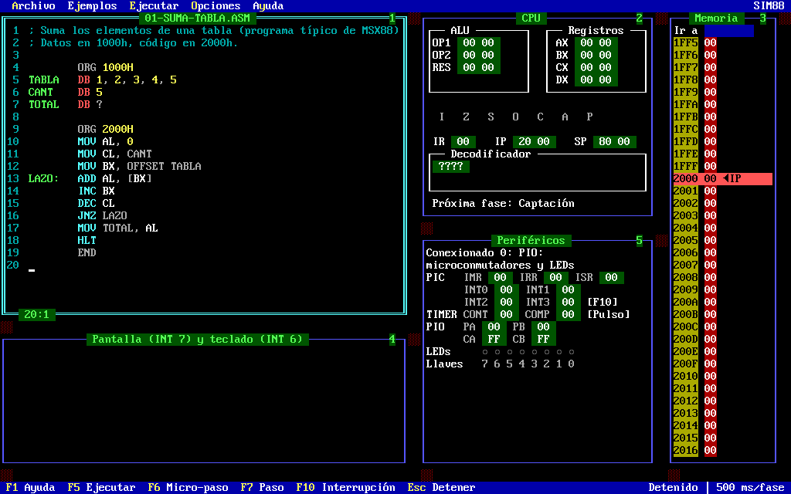
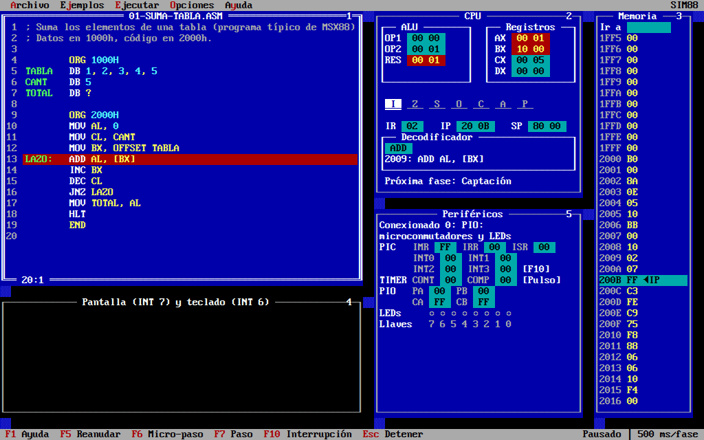
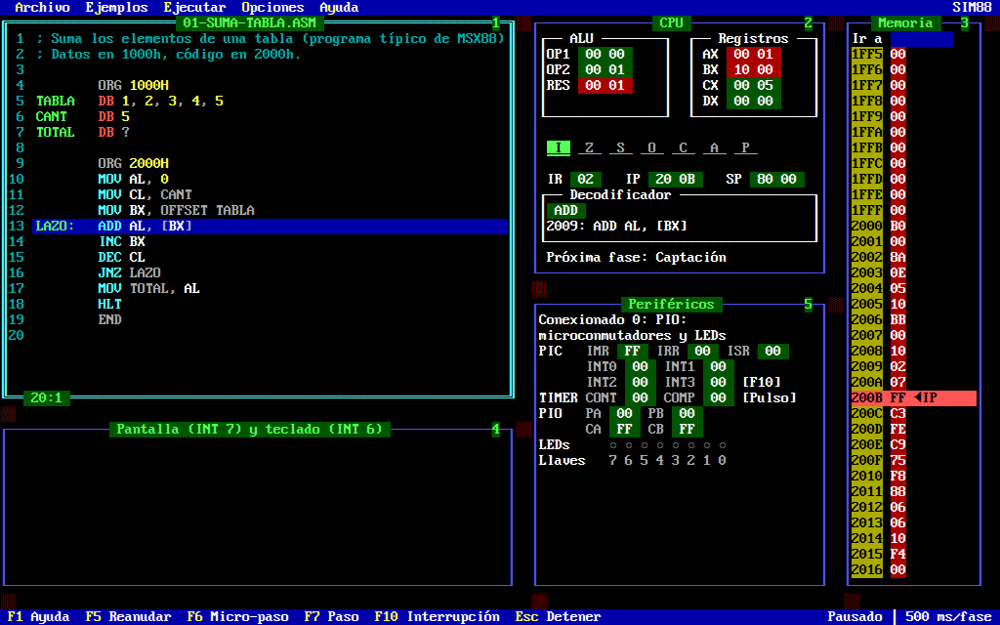
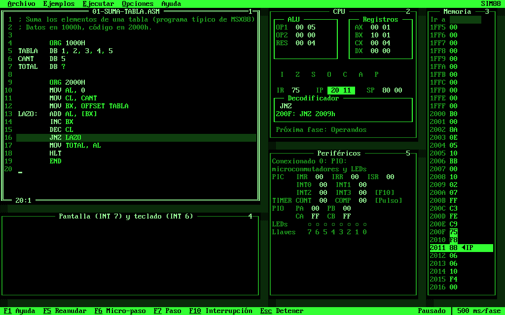
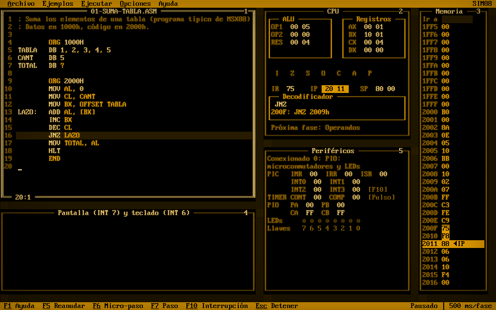
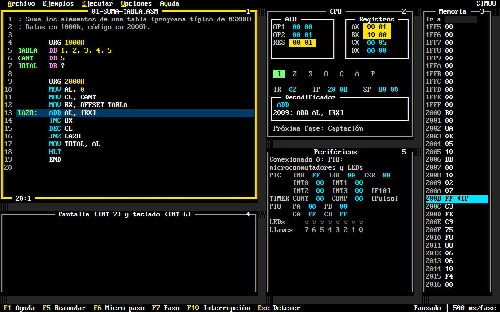
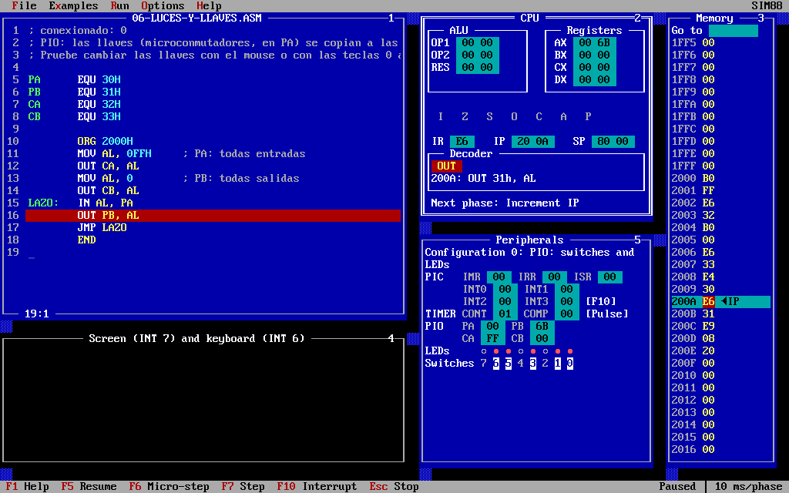

# SIM88

[](https://github.com/sawady/sim88/actions/workflows/ci.yml)
[](https://github.com/sawady/sim88/actions/workflows/deploy.yml)

**Try it in the browser: <https://sawady.github.io/sim88/>** (no installation needed).

An educational simulator of a simplified Intel 8088 CPU that runs in the browser.

You write a small assembly program, SIM88 assembles it into memory and runs it
one fetch–decode–execute step at a time, highlighting the registers, the
instruction register, the decoder and the memory cell being used at each step.



The interface is a text mode screen in the style of the MS-DOS tools of the time (Turbo Pascal,
MSX88 itself): VGA font, menu bar, function key bar, windows with double line frames and
shadows, and dialogs, all usable with the keyboard or the mouse.

| Classic blue | MSX88 | Green phosphor |
|---|---|---|
|  |  |  |
| **Amber phosphor** (CRT effect on) | **High contrast** | **English**, switches and LEDs |
|  |  |  |

## Who is it for

SIM88 is meant for introductory **Computer Organization** / **Computer
Architecture** courses that teach how a CPU works using a reduced 8088/8086
instruction set, in the style of classroom simulators such as MSX88:
registers and flags, the fetch–decode–execute cycle, addressing modes, the
stack, subroutines, interrupts and simple I/O peripherals.

The interface is in **Spanish or English**: it follows the browser's language the first time,
and **Options › Language** (Opciones › Idioma) switches it, assembler errors included. The
choice is remembered.

## Status

SIM88 is **work in progress**; [PROGRESS.md](PROGRESS.md) has the plan and what is done.
It follows the dialect and conventions of MSX88: data at `ORG 1000h`, code at `ORG 2000h`,
`INT 0` to finish (`HLT` waits for an interrupt, as in MSX88), `END` to close the source.

**Fidelity:** a corpus of test programs runs on the original MSX88 and on SIM88, and the
results are compared in CI: see [docs/fidelity.md](docs/fidelity.md) (63 of 65 programs match;
the 2 differences are explained there).

What works today:

- Assembler: labels (`LOOP:`), variables (`DB`, `DW`, `?`, lists, strings, `DUP`), constants
  (`EQU`), `ORG`, `OFFSET`, `BYTE PTR` / `WORD PTR`, expressions, and errors with the line.
- Instructions, encoded with real 8086 opcodes: `MOV`, `ADD`, `ADC`, `SUB`, `SBB`, `CMP`, `AND`,
  `OR`, `XOR`, `NOT`, `NEG`, `INC`, `DEC`, `PUSH`, `POP`, `PUSHF`, `POPF`, `JMP`, `JZ`, `JNZ`,
  `JS`, `JNS`, `JC`, `JNC`, `JO`, `JNO`, `CALL`, `RET`, `INT`, `IRET`, `STI`, `CLI`, `IN`, `OUT`,
  `NOP`, `HLT`.
- Addressing modes: immediate, register, direct (`VAR`, `[1000h]`) and indirect through `[BX]`.
- Flags Z, S, O, C, A, P and I; 64 KB of memory; interrupt vector table; INT 0 (end),
  INT 3 (breakpoint), INT 6 (read a key) and INT 7 (write to the screen).
- `IN` / `OUT` and the MSX88 peripherals, in its four configurations: PIO with
  switches and LEDs, PIC (F10 key, `HLT` waits for an interrupt), timer, printer through the
  PIO or the handshake (HAND), and the DMA controller (CDMA).
- Execution animated phase by phase (fetch, decode, IP, operands, execute) at adjustable
  speed, or step by step: one instruction, one phase, or **one instruction back**.

The **Examples** menu has a program for each topic (from a table sum to the DMA controller), and
the program being edited is kept in the browser between visits.

**Options** also has:

- **Configuration**: the four MSX88 peripheral configurations.
- **Frequencies**: the timer clock (1 Hz in real time by default; 0.5, 2, 5, 10 Hz or any value
  from 0.1 to 50 Hz) and the printer speed (one character every 8 instructions by default).
- **ALU: MSX88 or 8086**: where MSX88 and a real 8086 differ (see below), behave as MSX88 (the
  default) or as the 8086.
- **Appearance**: the theme (classic blue, MSX88, green phosphor, amber phosphor, high contrast),
  an optional CRT effect (scanlines, off by default) and the text size. The grid is scaled by
  whole factors of the 8x16 font where the screen allows it.
- **Language**.

**MSX88 strict mode** (Options menu) rejects what SIM88 accepts beyond the MSX88 dialect:
character literals (`'A'`), single-quoted strings, direct addresses in brackets (`[1000h]`), and
`*` / `/` in expressions. Where MSX88 differs from a real 8086, SIM88 follows MSX88: `JMP` and
`CALL` carry an absolute address, so the bytes match ASM88 listings, and the ALU behaves as
MSX88's unless you choose otherwise (below).

Where SIM88 is not sure to behave like MSX88, PROGRESS.md lists it under "Open questions".

### MSX88 and the 8086

MSX88 V-3.1 does four things differently from a real 8086 (checked by running the original, see
[docs/fidelity.md](docs/fidelity.md)). By default SIM88 does what MSX88 does, because results
then match the original simulator, which course exercises and listings are checked against.
**Options › ALU** switches to what the 8086 does, which makes a good classroom discussion
(**Help › Differences from the 8086** shows the same table):

| Instruction | As MSX88 (default) | As a real 8086 |
|---|---|---|
| `INC`, `DEC` | clear C | leave C alone |
| `ADC`, `SBB` with C = 1 | add (subtract), then `INC` (`DEC`) the result; the flags are those of the `INC` (`DEC`), so C ends 0 | one addition (subtraction) with the carry; C, O and A of the whole result |
| `NOT` | sets flags: 8 bits leave Z = P = 1 and the rest 0; 16 bits leave all 0 | changes no flag |
| `PUSH SP` | pushes 0000h | pushes SP after the decrement (SP − 2), as the 8086 and 8088 do |

So with the MSX88 ALU a multi-word addition (`ADD` then `ADC`, `ADC`...) loses the carry out of
any word after the first, and `INC CX` in a loop clears a carry the program wanted to keep. The
choice is remembered, applies from the next instruction, and the status bar shows `ALU 8086`
while it is on.

### HLT

`HLT` waits for an interrupt, even when none can arrive (I = 0 or every PIC line masked), as
MSX88 does: only F10 (when the PIC lets it through) or Esc gets it out. Programs that end in
`HLT` therefore stay there; the status bar says *CPU halted (HLT): waiting for an interrupt —
Esc to stop* for as long as it lasts, and the CPU window shows the same in place of the next
phase.

## Example

```asm
; Sum of a table
        ORG 1000H
TABLA   DB 1, 2, 3, 4, 5
CANT    DB 5
TOTAL   DB ?

        ORG 2000H
        MOV AL, 0
        MOV CL, CANT
        MOV BX, OFFSET TABLA
LAZO:   ADD AL, [BX]
        INC BX
        DEC CL
        JNZ LAZO
        MOV TOTAL, AL
        HLT
        END
```

## Running locally

Requires Node.js 20.19+ (CI uses Node 24). `npm install` also downloads the screen font (see
Credits), so the first install needs network access.

```sh
npm install
npm run dev      # development server at http://localhost:5173
npm test         # unit tests (Vitest)
npm run build    # production build in dist/
npm run preview  # serve the production build
```

Keyboard shortcuts (the ones MSX88 has work the same): `F1` keys, `F5` run / pause / resume,
`F6` micro-step (one phase of the cycle), `F7` step (one instruction), `Shift+F7` step back,
`Esc` stop, `F8` reset, `F10` interrupt (PIC INT0), `0`–`7` flip the switches,
`+` / `-` (or `Ctrl+Alt+I` / `Ctrl+Alt+D`) faster/slower,
`Ctrl+N` new, `Ctrl+O` open, `Ctrl+S` save, `Ctrl+Shift+S` save as.
`Alt` alone or `Alt` + the highlighted letter opens the menus; `Alt+1` to `Alt+5` go to the
windows (editor, CPU, memory, screen, peripherals).

## Project layout

```
src/grammar.pegjs        grammar of one source line (compiled with peggy at build/test time)
src/model/parser.js      splits the source into lines and parses them
src/model/assembler.js   two-pass assembler: symbols, ORG, data, encoding
src/model/isa.js         instruction table shared by the assembler and the decoder
src/model/decoder.js     8086 decoder (opcode table + ModRM)
src/model/alu.js         pure 8/16 bit ALU with flags
src/model/cpu.js         CPU state (64 KB Uint8Array) and instruction execution
src/model/io.js          I/O bus (IN/OUT) and the device interface
src/model/devices/       MSX88 peripherals (PIC, timer, PIO, HAND, printer, CDMA) and configurations
src/model/machine.js     the fetch-decode-execute cycle as the UI shows it, history for step back
src/model/__tests__/     model tests
src/actions, reducers    Redux glue (settings.js: language, theme, frequencies)
src/components/          React UI; tui/ has the text mode parts (grid, windows, menus, dialogs)
src/i18n/                es.js and en.js dictionaries; messages.js translates the model's messages
src/styles/themes.css    the themes, as CSS variables (a test checks their contrast)
scripts/fetch-font.mjs   downloads the font at install time
```

Every function of the model returns a new state. Memory is copied only when an instruction
writes it, so keeping one snapshot per instruction (for "step back") is cheap.

## Deployment

Every push to `master` is built and published to GitHub Pages by
`.github/workflows/deploy.yml` (Pages must be configured with
"Source: GitHub Actions").

## Contributing

The plan, its progress and the design decisions live in [PROGRESS.md](PROGRESS.md).
Bug reports, questions and ideas are welcome as GitHub issues; see
[CONTRIBUTING.md](CONTRIBUTING.md). Changes are listed in [CHANGELOG.md](CHANGELOG.md).

## Credits

The screen font is **IBM VGA 8x16** from [The Ultimate Oldschool PC Font
Pack](https://int10h.org/oldschool-pc-fonts/) by VileR, licensed under
[CC BY-SA 4.0](https://creativecommons.org/licenses/by-sa/4.0/). It is downloaded by
`scripts/fetch-font.mjs` when installing (checked against a SHA-256 sum), not kept in this
repository, and served from the site itself. The look follows MSX88 by R. de Diego and the
Borland IDEs of the early 1990s.

## License

[MIT](LICENSE) © Federico Sawady. The font has its own license (see Credits).
