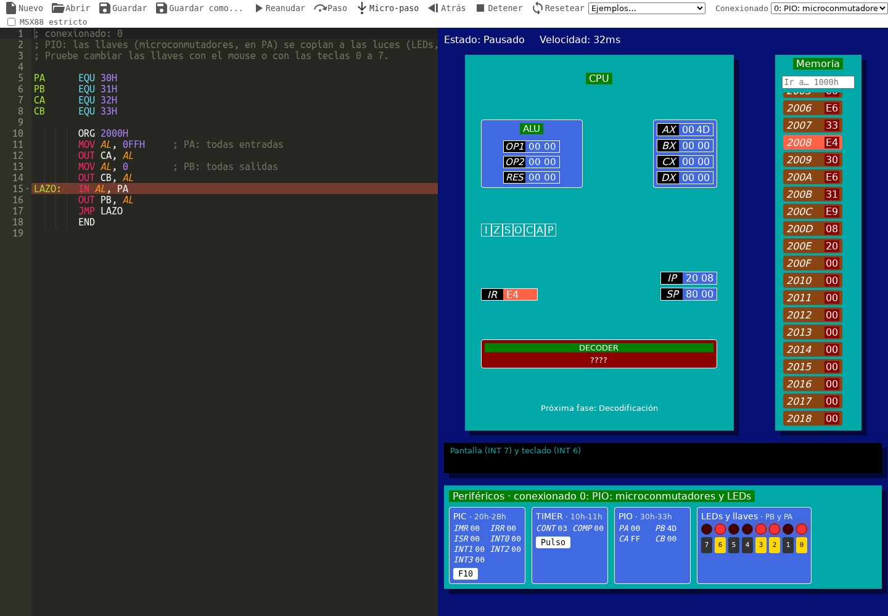

# SIM88

An educational simulator of a simplified Intel 8088 CPU that runs in the browser.

You write a small assembly program, SIM88 assembles it into memory and runs it
one fetch–decode–execute step at a time, highlighting the registers, the
instruction register, the decoder and the memory cell being used at each step.



## Who is it for

SIM88 is meant for introductory **Computer Organization** / **Computer
Architecture** courses that teach how a CPU works using a reduced 8088/8086
instruction set, in the style of classroom simulators such as MSX88:
registers and flags, the fetch–decode–execute cycle, addressing modes, the
stack, subroutines, interrupts and simple I/O peripherals.

The user interface is currently in Spanish (internationalization es/en is
planned).

## Status

SIM88 is **work in progress**; [PROGRESS.md](PROGRESS.md) has the plan and what is done.
It follows the dialect and conventions of MSX88: data at `ORG 1000h`, code at `ORG 2000h`,
`HLT` or `INT 0` to finish, `END` to close the source. What works today:

- Assembler: labels (`LOOP:`), variables (`DB`, `DW`, `?`, lists, strings, `DUP`), constants
  (`EQU`), `ORG`, `OFFSET`, `BYTE PTR` / `WORD PTR`, expressions, and errors with the line.
- Instructions, encoded with real 8086 opcodes: `MOV`, `ADD`, `ADC`, `SUB`, `SBB`, `CMP`, `AND`,
  `OR`, `XOR`, `NOT`, `NEG`, `INC`, `DEC`, `PUSH`, `POP`, `PUSHF`, `POPF`, `JMP`, `JZ`, `JNZ`,
  `JS`, `JNS`, `JC`, `JNC`, `JO`, `JNO`, `CALL`, `RET`, `INT`, `IRET`, `STI`, `CLI`, `IN`, `OUT`,
  `NOP`, `HLT`.
- Addressing modes: immediate, register, direct (`VAR`, `[1000h]`) and indirect through `[BX]`.
- Flags Z, S, O, C, A, P and I; 64 KB of memory; interrupt vector table; INT 0 (end),
  INT 3 (breakpoint), INT 6 (read a key) and INT 7 (write to the screen).
- `IN` / `OUT` and the MSX88 peripherals, in its four configurations (toolbar): PIO with
  switches and LEDs, PIC (F10 key, `HLT` waits for an interrupt), timer, printer through the
  PIO or the handshake (HAND), and the DMA controller (CDMA).
- Execution animated phase by phase (fetch, decode, IP, operands, execute) at adjustable
  speed, or step by step: one instruction, one phase, or **one instruction back**.

The **Ejemplos** menu has a program for each topic (from a table sum to the DMA controller), and
the program being edited is kept in the browser between visits.

**MSX88 strict mode** (toolbar toggle) rejects what SIM88 accepts beyond the MSX88 dialect:
character literals (`'A'`), single-quoted strings, direct addresses in brackets (`[1000h]`), and
`*` / `/` in expressions. Where MSX88 differs from a real 8086, SIM88 follows MSX88: `JMP` and
`CALL` carry an absolute address and `NOP` is 98h, so the bytes match ASM88 listings.

Where SIM88 is not sure to behave like MSX88, PROGRESS.md lists it under "Open questions".

## Example

```asm
; Sum of a table
        ORG 1000H
TABLA   DB 1, 2, 3, 4, 5
CANT    DB 5
TOTAL   DB ?

        ORG 2000H
        MOV AL, 0
        MOV CL, CANT
        MOV BX, OFFSET TABLA
LAZO:   ADD AL, [BX]
        INC BX
        DEC CL
        JNZ LAZO
        MOV TOTAL, AL
        HLT
        END
```

## Running locally

Requires Node.js 20.19+ (CI uses Node 24).

```sh
npm install
npm run dev      # development server at http://localhost:5173
npm test         # unit tests (Vitest)
npm run build    # production build in dist/
npm run preview  # serve the production build
```

Keyboard shortcuts (the ones MSX88 has work the same): `F5` run / pause / resume,
`F6` micro-step (one phase of the cycle), `F7` step (one instruction), `Shift+F7` step back,
`Esc` stop, `F8` reset, `F10` interrupt (PIC INT0), `0`–`7` flip the switches,
`+` / `-` (or `Ctrl+Alt+I` / `Ctrl+Alt+D`) faster/slower,
`Ctrl+N` new, `Ctrl+O` open, `Ctrl+S` save, `Ctrl+Shift+S` save as.

## Project layout

```
src/grammar.pegjs        grammar of one source line (compiled with peggy at build/test time)
src/model/parser.js      splits the source into lines and parses them
src/model/assembler.js   two-pass assembler: symbols, ORG, data, encoding
src/model/isa.js         instruction table shared by the assembler and the decoder
src/model/decoder.js     8086 decoder (opcode table + ModRM)
src/model/alu.js         pure 8/16 bit ALU with flags
src/model/cpu.js         CPU state (64 KB Uint8Array) and instruction execution
src/model/io.js          I/O bus (IN/OUT) and the device interface
src/model/devices/       MSX88 peripherals (PIC, timer, PIO, HAND, printer, CDMA) and configurations
src/model/machine.js     the fetch-decode-execute cycle as the UI shows it, history for step back
src/model/__tests__/     model tests
src/actions, reducers    Redux glue
src/components/          React UI
```

Every function of the model returns a new state. Memory is copied only when an instruction
writes it, so keeping one snapshot per instruction (for "step back") is cheap.

## Deployment

Every push to `master` is built and published to GitHub Pages by
`.github/workflows/deploy.yml` (Pages must be configured with
"Source: GitHub Actions").

## Contributing

The plan, its progress and the design decisions live in [PROGRESS.md](PROGRESS.md).
Bug reports, questions and ideas are welcome as GitHub issues; see
[CONTRIBUTING.md](CONTRIBUTING.md).

## License

[MIT](LICENSE) © Federico Sawady
